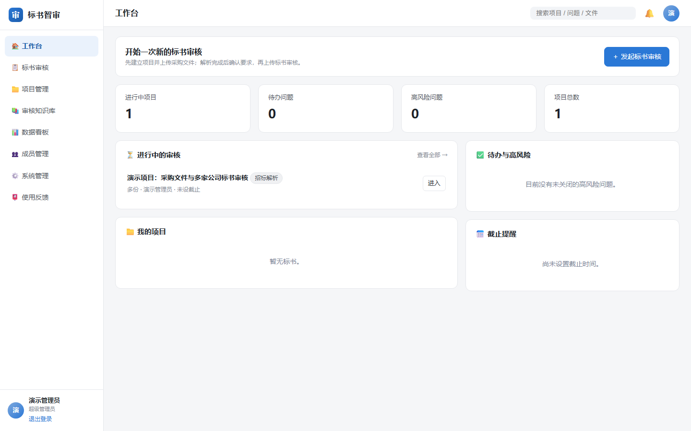
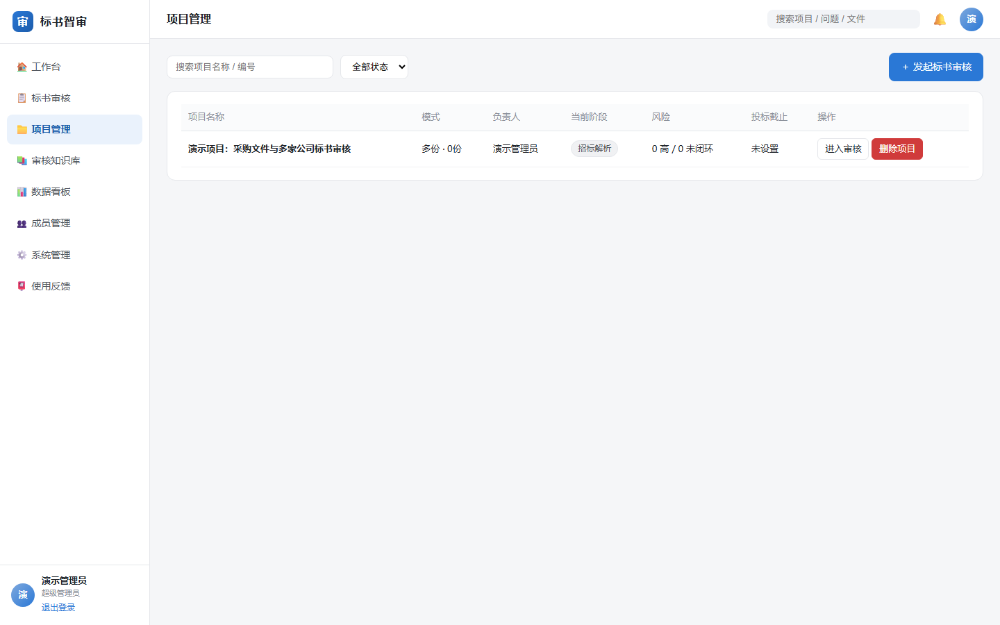
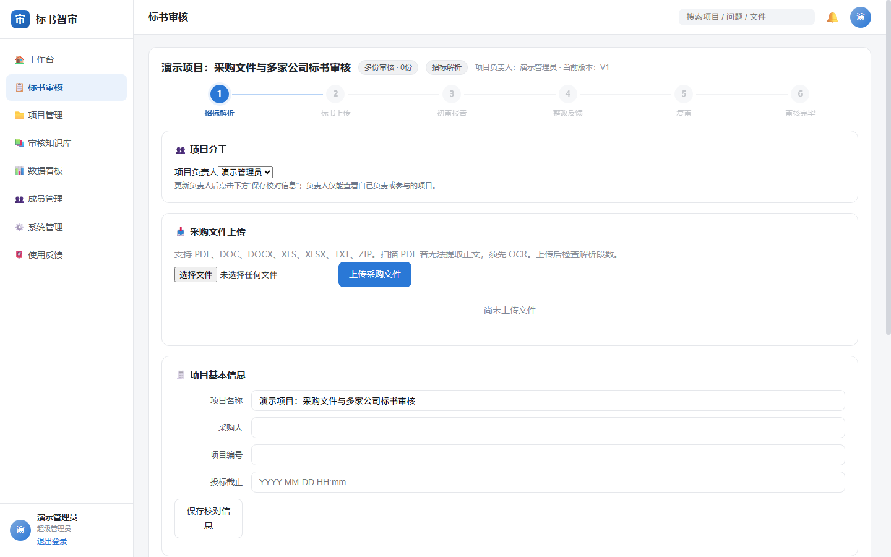

# 标书智审 · 售前团队标书审核工作台

标书智审是运行在本机的 Web 工作台，帮助售前团队把采购文件要求与标书内容逐项对照，并管理初审、整改和复审。系统提供问题线索与原文定位，最终结论由项目负责人核实。

> 当前为本地部署版本。AI 审核可能漏报或误报，不能替代逐页人工复核，也不能保证投标结果、得分或避免废标。

## 界面预览

以下截图来自隔离的演示项目，不包含真实采购文件、客户标书或模型密钥。

### 工作台



### 项目管理



### 标书审核流程



## 主要流程

1. **创建项目**：选择单份或多份标书审核，设置项目负责人。
2. **上传采购文件**：解析采购要求，查看售前重点、响应文件组成、格式和评分规则，并核对原文。
3. **上传标书**：多份标书按公司和负责人分别管理；同一项目共用采购文件。
4. **运行审核**：分别检查完整性、格式、实质性响应和评分材料；多份标书可进行相似性线索检查。
5. **整改与复审**：对问题记录处理意见，上传修订版后重新审核，保留版本和处理记录。

审核结果按采购要求与标书证据对照展示。图片 OCR 只提供待核验线索；主体、日期、签章、证书有效性以及截图内容仍需打开原件确认。

## 本地运行

需要 **Node.js 22 或更高版本**。

```bash
npm install
npm start
```

Windows 也可运行 `start.bat`。启动后打开 <http://127.0.0.1:4173/>。首次进入需创建超级管理员账号，然后由管理员配置模型。

在系统管理页面配置兼容 OpenAI Chat Completions 的模型地址、模型名和 API Key；也可在项目根目录创建 `.env`：

```dotenv
MODEL_BASE_URL=https://your-model-endpoint/v1
MODEL_NAME=your-model-name
MODEL_API_KEY=your-api-key
PORT=4173
DATA_DIR=./data
```

不要将 `.env`、`settings.json` 或真实标书上传到公开仓库。它们已列入 `.gitignore`，仍请在提交前检查文件清单。

## 文件与审核边界

| 类型 | 当前处理方式 |
| --- | --- |
| DOCX / DOCM | 提取正文、表格与图片锚点；在 Windows 上尝试对嵌入图片进行 OCR |
| DOC | 尝试解析旧版 Word；无法识别时显示未覆盖 |
| PDF | 提取可读取的文本；扫描 PDF 无正文时需先做 OCR |
| XLSX / XLSM、PPTX、TXT / MD / CSV | 提取可读取的文本或结构 |
| XLS / PPT、独立图片 | 当前不能直接完成可靠的正文审核，需转换格式或人工核对 |
| ZIP | 上传流程可展开支持的文件；应检查解包后每个文件的解析状态 |

格式核查中的字体、字号、行距、下划线、括号及签章位置等视觉差异，仍需要对照原文件人工确认。OCR 文字可能有识别错误，不能作为自动放行依据。多份标书相似性检查仅呈现需核实的线索，不作串通投标认定。

## 项目结构

```text
server/              Node.js HTTP 服务、权限、文件解析与审核引擎
server/parsers/      DOCX / PDF / Office 文档解析及 Windows OCR
server/engine/       采购要求、证据检索、审核、复审等逻辑
web/                 工作台页面
scripts/             集成与验收脚本
docs/images/         README 演示截图
```

## 验证

```bash
node scripts/test-workstation.mjs
```

该脚本使用隔离的临时数据目录，覆盖登录、角色权限、项目、多主体文件、采购要求及整改流程等接口。实际项目仍需使用采购文件和标书进行人工抽样复核。

## 数据与部署说明

服务默认只监听 `127.0.0.1`，数据保存在本机 `data/`。当前存储和服务形态适合本机试用；如果要让团队成员从不同电脑同时使用，需要进一步设计部署、备份、权限和并发存储。飞书登录界面目前为待配置入口。
